### Hello World! 👋

<!--
**Abhiek187/Abhiek187** is a ✨ _special_ ✨ repository because its `README.md` (this file) appears on your GitHub profile.

Here are some ideas to get you started:

- 🔭 I’m currently working on ...
- 🌱 I’m currently learning ...
- 👯 I’m looking to collaborate on ...
- 🤔 I’m looking for help with ...
- 💬 Ask me about ...
- 📫 How to reach me: ...
- 😄 Pronouns: ...
- ⚡ Fun fact: ...
-->

```json
{
  "name": "Abhishek Chaudhuri",
  "pronouns": "he/him",
  "currentRole": "Lead Software Engineer at Prudential Financial 📱🖥️",
  "education": "BS/MS in Electrical & Computer Engineering at Rutgers University ⚡",
  "favoriteLanguages": [
    "TypeScript",
    "Swift",
    "Kotlin",
    "Python"
  ],
  "interests": [
    "Front-End Development",
    "Full-Stack Development",
    "Machine Learning"
  ],
  "hobbies": [
    "Video Games 🎮",
    "Exercising 💓",
    "Investing in Crypto 💲"
  ],
  "funFact": "I play the flute and piccolo and performed in a marching band. 🎼"
}
```

<!-- [](https://github.com/anuraghazra/github-readme-stats) -->
<!---->

<!--  -->

<!--  -->
